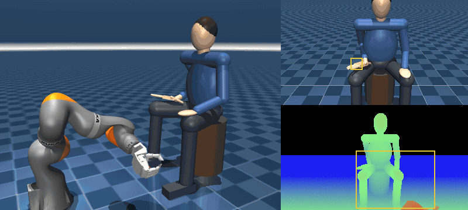
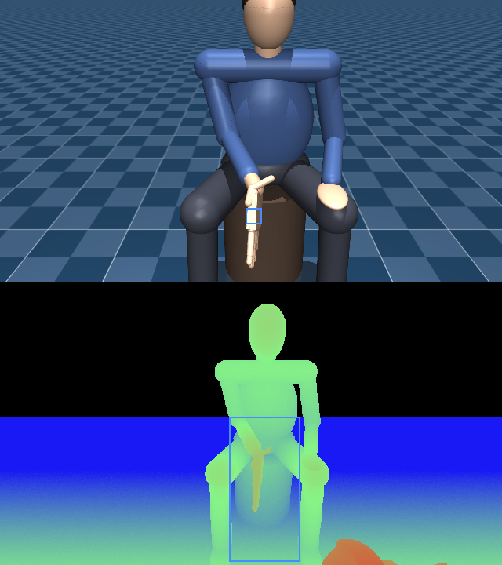
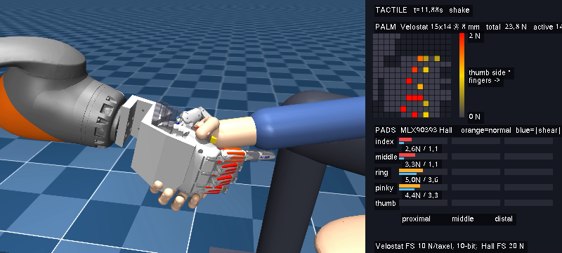
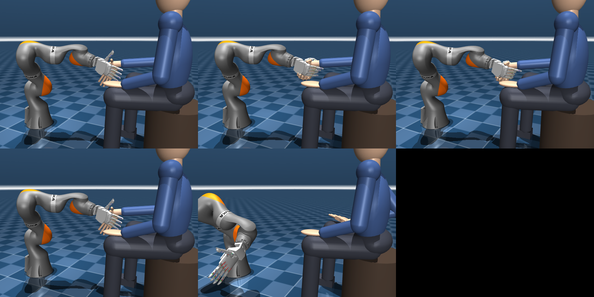

# KUKA iiwa + Aero Hand: a robot that shakes your hand

A MuJoCo simulation of a **KUKA LBR iiwa 14** arm with a **TetherIA Aero Hand Open**. The robot
watches a seated person with a head camera; when the person **offers** their hand, it reaches
out to wherever that hand is, shakes it gently and lets go. A simulated tactile skin
(Velostat palm matrix + MLX90393 Hall pads) measures the contact the whole time.



*One episode at 1.5× speed. Right: the robot's RGB-D head camera, with the hand detection
(yellow = tracking, green = offered, blue = robot committed). Recreate with `python make_gif.py`.*

## What it does

- **Sees** — a head camera modelled on an Intel RealSense D435 (RGB + noisy depth) finds and
  tracks the person's hand at 10 Hz.
- **Decides** — it responds only to a hand that is *offered*: inside a 10 cm meeting zone and
  held still for 0.4 s. Waving or hesitating doesn't trigger it.
- **Reaches** — to the detected hand, from a tucked home pose, then straight in.
- **Shakes** — the person closes their hand first, then the robot wraps, three gentle pumps
  (22 mm at 1.25 Hz), the robot lets go first, then the person.
- **Feels** — palm and finger sensors read the grip; the robot backs off if its palm feels no
  hand when it arrives, and aborts if the hand is pulled away while it reaches.

| What the robot sees when it commits | The tactile readout while holding |
| --- | --- |
|  |  |


*Approach → grip → shake → release → home (from `python handshake.py --check`).*

## Results

From `python handshake.py --check`, which runs a fixed script of six episodes (offer, wave,
offer, hesitate, offer then pull back, offer), over three random seeds:

| Measure | Result |
| --- | --- |
| Offers that led to a handshake | 9 / 9 (hands offered up to 7 cm from the nominal spot) |
| False triggers on waving or hesitating | 0 / 6 |
| Offers pulled back while the robot reached | 3 / 3 aborted |
| Time from the hand stopping to the robot committing | 0.42–0.60 s |
| Hand position estimate when committing | 1–5 mm from the true position |
| Max overlap between the hands during the shake | ≤ 4.5 mm |
| Palm contact while holding | ~28 N spread over 14 taxels |

## Setup

Tested on Windows 11 with Python 3.12 and MuJoCo 4.0.

```bash
git clone https://github.com/Balu-monish/kuka-aero-handshake
cd kuka-aero-handshake
python -m venv .venv
.venv\Scripts\activate            # Linux/macOS: source .venv/bin/activate
pip install -r requirements.txt
```

The robot models come from two upstream repositories, cloned into this folder (they are
git-ignored):

```bash
# Aero Hand Open (only its MuJoCo simulation submodule is needed)
git clone https://github.com/TetherIA/aero-hand-open
git -C aero-hand-open submodule update --init sim_rl/simulation

# MuJoCo Menagerie, sparse: just the KUKA iiwa 14
git clone --filter=blob:none --sparse https://github.com/google-deepmind/mujoco_menagerie
git -C mujoco_menagerie sparse-checkout set kuka_iiwa_14

python build_scene.py             # combines them into scene.xml
```

## Run

```bash
python handshake.py                 # viewer + control window: press Start to let the robot respond
python handshake.py --autostart     # robot responds right away
python handshake.py --seed 3        # repeatable person behaviour (default: random)
python handshake.py --no-headcam    # hide the camera view (the viewer runs faster)
python handshake.py --check         # headless test script: metrics + media/handshake_frames.png
python handshake.py --record media/headcam_view.mp4 --headcam --cycles 2   # scene + head camera video
python handshake.py --record media/handshake_tactile.mp4 --tactile         # tactile close-up video
python make_gif.py                  # media/handshake.gif
python -m mujoco.viewer --mjcf=scene.xml                                   # static scene only
```

The control window has **Start / Stop** (or Space/Enter there, Enter in the 3D viewer), the
head-camera view and the live tactile panel. The person behaves on their own from the
start: resting, offering a hand, waving, hesitating, or offering and pulling back. Start
lets the robot respond; Stop winds it down gracefully from any state.

## How it works

**Robot.** The Aero Hand is mounted flush on the iiwa flange (`build_scene.py`). The arm is
position-controlled with gravity compensation and damped-least-squares inverse kinematics.
At home it is tucked low on its right, out of the camera's view of where hands are offered.
The handshake posture keeps the elbow up and out and the wrist well away from the iiwa's
wrist singularity, so even off-nominal meeting points shake smoothly. The hand's tendon
motors are capped at 20 N (an assumption; the source model has no limit).

**Person** (`human_body.py`, `human_agent.py`). A seated body around an anatomical right hand
(`partner_hand.py`): palm, thenar pad, four 3-segment fingers and a 3-segment thumb, with
soft position motors so it grips back. The palm face is a grid of 30 spring-loaded tissue
pads over a rigid core, so it conforms to the robot's stepped palm and spreads the load. A
scripted behaviour moves the hand: offers land at a random spot within ±5 cm of the
nominal meeting point.

**Head camera** (`head_camera.py`). Fixed about 0.6 m above the handshake, just behind the
robot's base, like eyes. Depth 848 × 480 at 87° × 58° (0.3–3 m, stereo noise growing with
distance), RGB 1280 × 720 at 69° × 42°.

**Detection and trigger** (`perception.py`). The hand mask comes from MuJoCo's segmentation
(an idealized 2D detector, meant to be swapped for a real one). Its pixels are back-projected
with the noisy depth; the median of the visible surface plus a calibrated offset gives the
hand position, smoothed by an alpha-beta tracker. When the robot's own hand covers the
person's (self-occlusion, known from its own geometry), the estimate is held.

**Handshake.** Reach to 15 cm short of the hand → straight-line approach → the person
closes their hand → the robot wraps (thumb abducted so it rests on the back of the
person's hand) → three gentle pumps with eased start and end → release in reverse order →
retreat → home.

**Tactile skin** (`tactile.py`, `readout.py`).
- *Palm:* a Velostat matrix of 138 taxels at 8 mm pitch, ray-cast onto the curved palm,
  with creep drift, noise, a deadband, 10 N/taxel full scale and a 10-bit ADC.
- *Fingers and thumb:* 14 MLX90393 Hall pads, one per phalanx, reading normal force and two
  shear axes; slip is flagged when a contact uses more than 80% of its friction cone.
- `--check` logs all of it to `media/tactile_log.csv` at 50 Hz.

## Development history

Each version is a git tag; click it to browse the code as it was. (Up to v6 the code lived
in a `kuka_aero/` subfolder.)

| Version | What changed | Key result |
| --- | --- | --- |
| [v1](https://github.com/Balu-monish/kuka-aero-handshake/tree/v1-iiwa-aero-scene) | Aero Hand mounted on the iiwa flange in one MuJoCo scene | Hand flush on the flange (0.00 mm off-centre) |
| [v2](https://github.com/Balu-monish/kuka-aero-handshake/tree/v2-handshake) | Inverse-kinematics reach, grip and shake with a compliant box as the partner; video recording | IK accurate to 0.3 mm; overlap ≤ 5.7 mm |
| [v3](https://github.com/Balu-monish/kuka-aero-handshake/tree/v3-anatomical-partner) | Anatomical human hand that grips back | Shake overlap median 0.9 mm |
| [v4](https://github.com/Balu-monish/kuka-aero-handshake/tree/v4-tactile-interlock) | Simulated tactile skin; searched placement so the hands interlock; 20 N tendon cap | 6–8 robot finger segments in contact; overlap up to 12.7 mm in the shake |
| [v5](https://github.com/Balu-monish/kuka-aero-handshake/tree/v5-gentle-handshake) | Gentle shake, person closes first, soft spring-pad palm, natural thumbs, Start/Stop window | Overlap 12.7 → 3.4 mm; palm contact from ~300 N on one point to ~26 N over 14 taxels |
| [v6](https://github.com/Balu-monish/kuka-aero-handshake/tree/v6-camera-trigger) | Head camera, seated person, hand detection; the robot starts the handshake itself | 9/9 offers shaken, 0/6 false triggers, commit ~0.5 s after the hand stops |

## Project layout

```
handshake.py      robot controller, viewer + control window, --check / --record
perception.py     hand detection, tracking and the "offered" trigger
head_camera.py    D435-like head camera (RGB, noisy depth, segmentation)
human_agent.py    the person's behaviour (rest, offer, wave, hesitate, withdraw)
human_body.py     the seated person's body (visual only)
partner_hand.py   the person's hand: fingers, thumb, soft palm pads, palm press
tactile.py        simulated Velostat palm matrix and Hall pads
readout.py        tactile panel for the control window and videos
build_scene.py    builds scene.xml from the upstream iiwa and Aero Hand models
check_scene.py    sanity checks on the static scene (media/snapshot.png)
make_gif.py       renders one episode to media/handshake.gif
media/            images, videos and check outputs
```

## Limitations and next steps

- The 2D hand mask comes from the simulator's segmentation; a real detector on the RGB image
  (for example MediaPipe Hands) should replace it before this goes near hardware.
- Only the hand's position is estimated; its orientation is assumed, so tilted offers aren't
  supported yet.
- While the robot's hand covers the person's, detection is paused; a wrist camera or the
  palm sensors could keep tracking through the final approach.
- The robot thumb touches the person's hand only part of the time during the shake.
- Several sensor and tissue parameters (Velostat creep, pad stiffness, the 20 N tendon cap)
  are assumptions that need calibrating against real hardware.

## Credits

Robot models: [TetherIA Aero Hand Open](https://github.com/TetherIA/aero-hand-open) and the
KUKA LBR iiwa 14 from [MuJoCo Menagerie](https://github.com/google-deepmind/mujoco_menagerie),
used unmodified under their own licenses. Simulation: [MuJoCo](https://mujoco.org).
